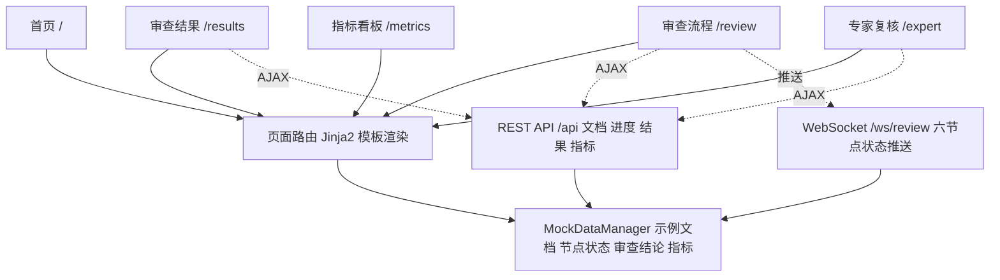
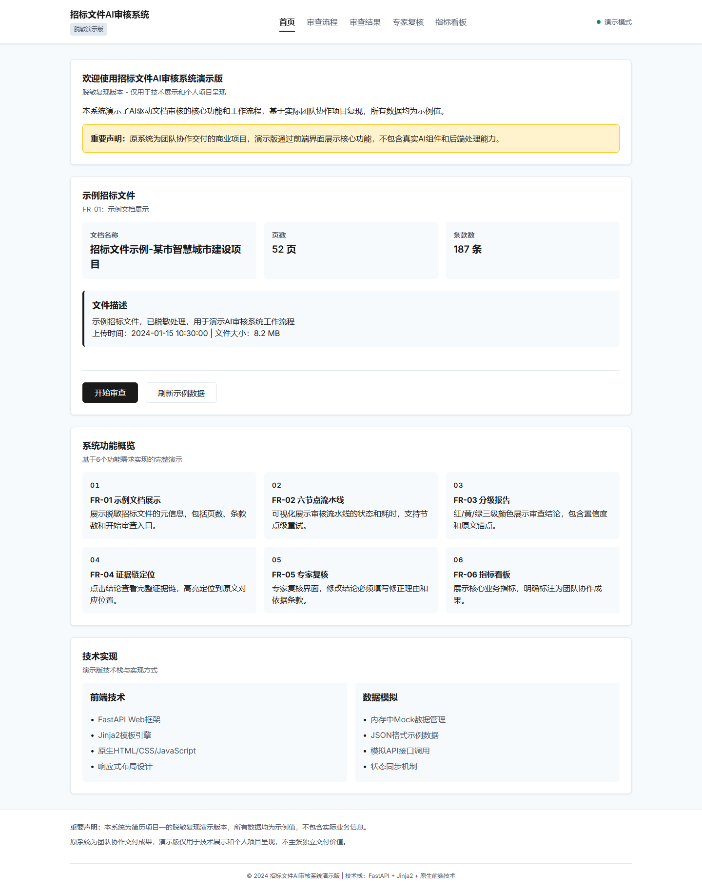
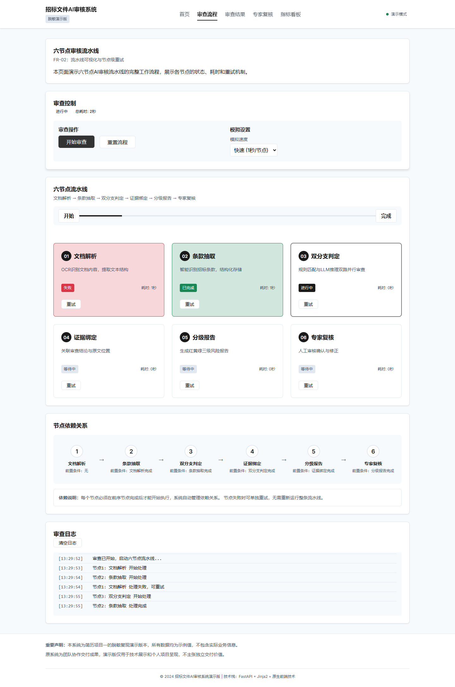
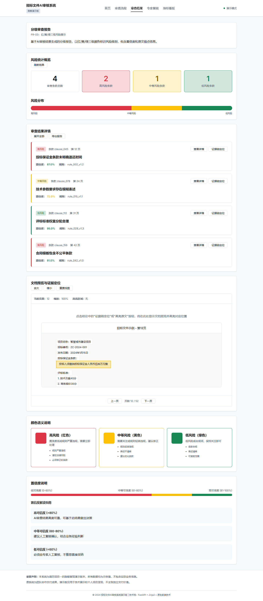
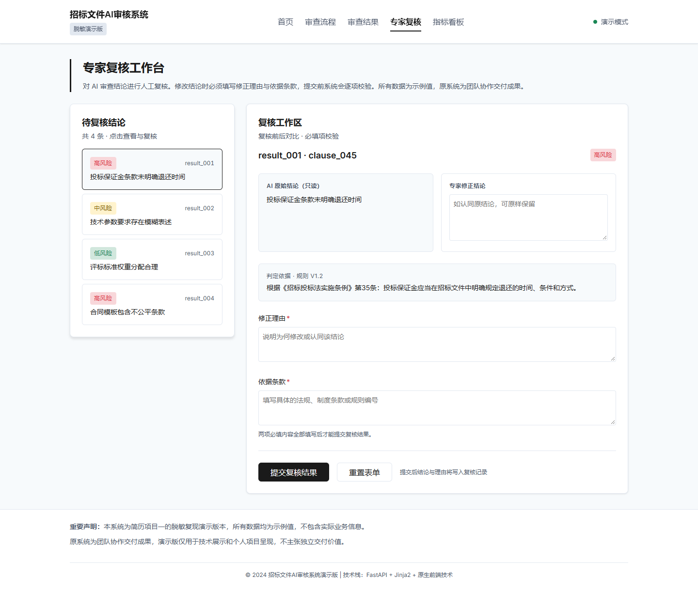
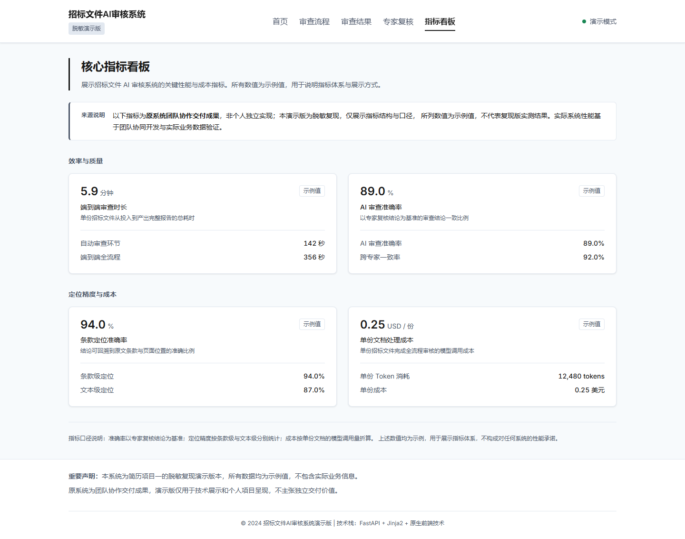

# 招标文件 AI 审核系统（演示复现版）


基于简历项目一脱敏复现的公开演示项目：以 FastAPI + Jinja2 实现可交互的前端演示页，呈现六节点审核流水线、分级报告、证据链定位与专家复核等核心流程。

> **说明**：`openspec/changes/central-state-owned-enterprise-bidding-procurement-audit-agent-system` 为完整系统设计规范；公开演示仅实现前端切片，见 `openspec/changes/archive/2026-11-25-public-demo-ui`。

原系统为团队协作交付，本文档与代码中的技术方案、架构设计及指标均为团队协作成果；演示数据均为模拟值，不含真实业务信息。

## 架构

公开演示是一个**纯本地、无外部依赖**的前端切片：FastAPI 同时承担页面渲染与数据接口，所有业务数据来自进程内的 `MockDataManager`；不包含真实的 OCR、LLM、向量库、Celery 或数据库。



完整系统设计（六节点状态机、双路判定引擎、证据链、专家回流、信创适配）见 `openspec/changes/central-state-owned-enterprise-bidding-procurement-audit-agent-system/`。

## Quick start

前置：Python 3.9+。**无需数据库、API Key、GPU 或任何外部服务**，依赖仅 4 个包。

```bash
# 1. 进入演示目录（模板与静态资源使用相对路径，必须在此目录启动）
cd demo-app

# 2. 创建并激活虚拟环境（推荐）
python -m venv .venv
source .venv/bin/activate          # Windows: .venv\Scripts\activate

# 3. 安装依赖
pip install -r requirements.txt

# 4. 启动服务
uvicorn main:app --reload --port 8000
```

浏览器打开 **http://localhost:8000**。验证接口：`http://localhost:8000/api/document` 应返回示例文档信息。

### 建议演示路径

1. **首页** `/`：查看脱敏示例文档元信息，点击「开始审查」
2. **审查流程** `/review`：六节点流水线逐步推进，可观察单节点重试与实时状态推送
3. **审查结果** `/results`：红/黄/绿三级结论 + 置信度 + 原文锚点，点开查看证据链与原文高亮定位
4. **专家复核** `/expert`：修改结论时必须填写修正理由与依据条款
5. **指标看板** `/metrics`：审查时长、准确率、定位准确率、token 成本，均标注来源

## 页面预览

| 首页 · 示例文档 | 审查流程 · 六节点状态 |
|---|---|
|  |  |

| 审查结果 · 分级报告与证据链 | 专家复核 · 必填校验 |
|---|---|
|  |  |

指标看板 · 四类指标与来源标注：



## 目录结构

```
.
├── demo-app/        # 可运行的前端演示（FastAPI + Jinja2）
├── openspec/
│   ├── specs/       # 归档后合并的主规范（frontend-demo）
│   └── changes/
│       ├── archive/2026-11-25-public-demo-ui/   # 演示切片的完整闭环
│       └── central-state-owned-.../             # 完整系统设计规范（设计参考）
└── 招标采购审核Agent化系统设计方案.md            # 脱敏后的系统设计方案
```
